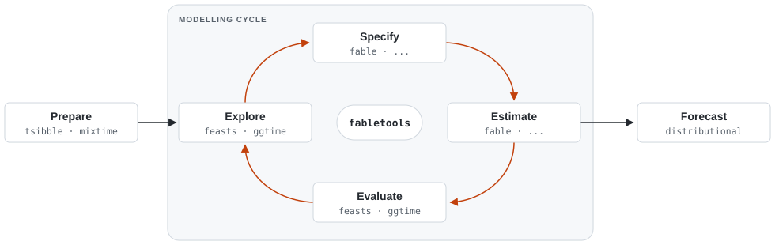
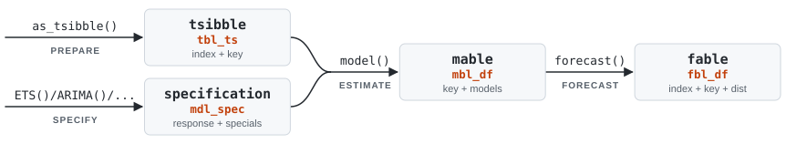
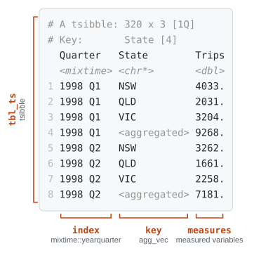
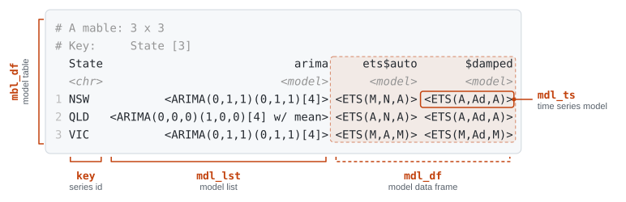
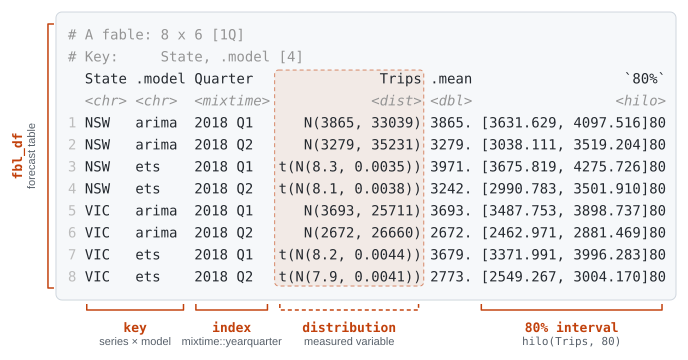
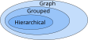
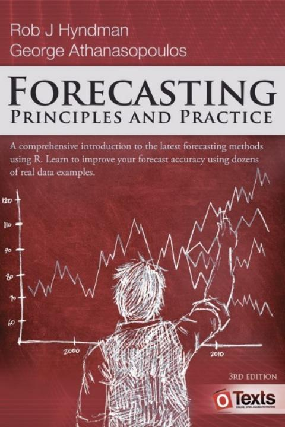

```{r}
#| label: setup
#| include: false
library(tidyverse)
library(visNetwork)
library(tidygraph)
library(gt)
# Development versions of the tidyverts packages (see renv.lock)
library(tsibble)
library(fable)
library(ggtime)
# Prototype graph pruning, from mitchelloharawild/paper-graph-pruning
source("R/prune.R")
# Animated graph walks that explain pruning
source("R/graph-walk.R")
options(width = 75)

# Deck palette, mirrored in custom.scss
deck_colours <- c(ink = "#1A1A1A", grey = "#5E5E5E", panel = "#E5E5E5", band = "#BFBFBF")
# Node colours by depth, shared by every graph in the talk (hex, as visNetwork
# doesn't know R colour names like grey70)
level_colours <- c("#8E8E8E", "#084887", "#8093F1", "#FBB13C", "#B388EB")
# Edge colours mean "which constraint / disaggregation path"
constraint_colours <- c("#1B998B", "#C33C8A", "#5E5E5E")
graph_font <- list(face = "Source Sans Pro", color = deck_colours[["ink"]])

knitr::opts_chunk$set(dev = "svg")
theme_deck <- function(base_size = 20) {
  theme_minimal(base_size = base_size, base_family = "Source Sans 3") +
    theme(
      legend.position = "top",
      panel.grid.minor = element_blank(),
      plot.margin = margin(5, 20, 5, 5),
      text = element_text(colour = deck_colours[["ink"]]),
      axis.text = element_text(colour = deck_colours[["grey"]])
    )
}
theme_set(theme_deck())
# Depth of each node from its nearest root, so disjoint graphs are coloured per component
graph_level <- function(data) {
  roots <- which(igraph::degree(data, mode = "in") == 0)
  apply(igraph::distances(data, v = roots, mode = "out"), 2, min)
}
colour_by_level <- function(nodes) {
  if (!"color" %in% names(nodes)) nodes$color <- level_colours[pmin(nodes$level, length(level_colours) - 1) + 1]
  nodes
}

visnetwork_hierarchy <- function(data, ...) {
  nodes <- as_tibble(mutate(activate(data, "nodes"), id = row_number(), level = graph_level(data))) |>
    colour_by_level()
  edges <- as_tibble(activate(data, "edges"))
  graph <- visNetwork(nodes, edges, ...) |>
    visHierarchicalLayout(direction = "UD", shakeTowards = "leaves") |>
    visOptions(
      highlightNearest = list(enabled = TRUE, degree = list(from = 50000, to = 0), hover = FALSE, algorithm = "hierarchical"),
      collapse = list(enabled = TRUE, fit = FALSE, resetHighlight = TRUE, keepCoord = TRUE,
                      clusterOptions = list(fixed = TRUE, physics = TRUE))
    ) |>
    visEdges(scaling = list(label = list(enabled = FALSE)), arrows = "to") |>
    visNodes(font = c(graph_font, size = 18))

  graph$x$tree <- list(updateShape = TRUE, shapeVar = "dot", shapeY = "square")
  graph
}
# DAGs are drawn top-down by depth too, so the top series is always at the top
visnetwork_graph <- function(data, layout = "hierarchical", ..., layout_args = list()) {
  nodes <- as_tibble(mutate(activate(data, "nodes"), id = row_number(), level = graph_level(data))) |>
    colour_by_level()
  if (layout != "hierarchical") nodes <- select(nodes, -level)
  edges <- as_tibble(activate(data, "edges"))
  graph <- visNetwork(nodes, edges, ...)
  graph <- if (layout == "hierarchical") {
    exec(visHierarchicalLayout, graph, direction = "UD", !!!layout_args)
  } else {
    exec(visIgraphLayout, graph, layout = layout, randomSeed = 123091238, !!!layout_args)
  }
  graph <- graph |>
    visOptions(
      highlightNearest = list(enabled = TRUE, degree = list(from = 50000, to = 0), hover = FALSE)
    ) |>
    visEdges(width = 3, smooth = FALSE, scaling = list(label = list(enabled = FALSE)), arrows = "to") |>
    visNodes(size = 20, font = c(graph_font, size = 18))

  graph$x$tree <- list(updateShape = TRUE, shapeVar = "dot", shapeY = "square")
  graph
}
```

```{r}
#| label: data
#| include: false
#| cache: true
fpp3_complete_ts <- readr::read_csv("fpp3_complete_raw.csv") |>
  rename(screenPageViews = pageviews, activeUsers = users) |>
  # Fill all structurally valid interactions to complete the bottom level series
  complete(date, deviceCategory, nesting(continent, subContinent, country), fill = list(screenPageViews = 0, activeUsers = 0)) |>
  group_by(date, deviceCategory, continent, subContinent, country) |>
  summarise(
    screenPageViews = sum(screenPageViews),
    activeUsers = sum(activeUsers),
    .groups = "drop"
  ) |>
  as_tsibble(index = date, key = c(deviceCategory, continent, subContinent, country)) |>
  fill_gaps(screenPageViews = 0, activeUsers = 0, .full = TRUE)
fpp3_complete_agg_ts <- fpp3_complete_ts |>
  aggregate_key(
    deviceCategory*(continent/subContinent/country),
    screenPageViews = sum(screenPageViews),
    activeUsers = sum(activeUsers)
  )
fpp3_pruned_ts <- fpp3_complete_ts |>
  prune_aggregates(
    deviceCategory * (continent / subContinent / country),
    .predicate = mean(activeUsers) > 10 & mean(activeUsers == 0) < 0.5,
    .keep = \(x) mean(x) > 0.5,
    activeUsers = sum(activeUsers)
  )
rm(fpp3_complete_ts)

# The walks also show an illustrative smart tv series under Western Europe,
# which isn't in this extract of the data
fpp3_walk_ts <- fpp3_complete_agg_ts |>
  add_example_series(deviceCategory = "smart tv", continent = "Europe", subContinent = "Western Europe")

# Favorita results use their own colours, so they don't read as graph levels.
# Forecasting stages share a colour wherever they appear (accuracy and compute plots)
result_colours <- c(
  "In-sample fit" = "grey60", "Base forecasts" = "#D55E00", "Bottom-up" = "#56B4E9", "MinT (WLS)" = "#009E73",
  "Base forecasts (ETS)" = "#D55E00", "Sample paths" = "#E69F00", "Reconcile (MinT WLS)" = "#009E73",
  "Pruning" = "grey20", "Coherency structure" = "grey50",
  RMSSE = "#0072B2", sCRPS = "#CC79A7"
)
# Unnamed discrete scales (e.g. autoplot() of ets vs mint) follow the same stages
options(
  ggplot2.discrete.colour = unname(result_colours[c("Base forecasts", "MinT (WLS)")]),
  ggplot2.discrete.fill = unname(result_colours[c("Base forecasts", "MinT (WLS)")])
)
```

##

::: columns
::: {.column width="37.5%"}
:::
::: {.column width="60%"}

::: {.title data-id="title"}
Graphs for forecasting
many related time series
:::

::: {.dateplace}
23rd October 2026 @ University of Melbourne
:::

<br>

Mitchell O'Hara-Wild, Monash University

<br><br>

::: {.callout-link}

## Useful links

{.icon} [social.mitchelloharawild.com](https://social.mitchelloharawild.com/)

{.icon} [slides.mitchelloharawild.com/UoM2026](https://slides.mitchelloharawild.com/UoM2026)

{.icon} [mitchelloharawild/talk-graph-temporal-uom2026](https://github.com/mitchelloharawild/talk-graph-temporal-uom2026)

:::

:::
:::

{.image-left}


<!-- ====================================================================== -->
<!-- Part 1: Software design for forecasting at scale                       -->
<!-- ====================================================================== -->


## {}

::: columns
::: {.column width="60%"}

### Forecasting in practice

Rarely just one time series.

::: {.fragment .fade-up}
::: {.callout-note}
## Many related series

Organisations forecast large collections of related series, e.g.

* visitors by origin and purpose of travel
* page views by country and device
* product sales across stores and regions

The M5 competition: 42,840 related retail series.
:::
:::

::: {.fragment .fade-up}
::: {.callout-question}
## What does software for this look like?

Many series and many models, through a single consistent interface.
:::
:::

:::
:::

{.image-right}


## {}

### Forecasting is more than fitting a model

{fig-align="center" width="100%"}

::: columns
::: {.column width="33%"}
::: {.fragment .fade-up}
::: {.callout-note icon=false}
## Consistent

One interface for every model and every series.
:::
:::
:::
::: {.column width="33%"}
::: {.fragment .fade-up}
::: {.callout-note icon=false}
## Extensible

New models and methods slot into the same workflow.
:::
:::
:::
::: {.column width="33%"}
::: {.fragment .fade-up}
::: {.callout-note icon=false}
## Probabilistic

Forecast distributions to evaluate, combine and compare.
:::
:::
:::
:::


## {.fragment-remove}

::: columns
::: {.column width="40%"}
:::
::: {.column width="60%"}

### A tidy data model for time series

The unit of analysis is the *collection*, not the individual series.

::: {.fragment .fade-out fragment-index=1}
{width="100%" fig-align="center"}
:::

::: {.fragment .fade-in-then-out fragment-index=1}
::: {.callout-note icon=false}
## tsibble

Time **index**, **key** variables identify each series.
:::

{width="70%" fig-align="center"}
:::

::: {.fragment .fade-in-then-out fragment-index=2}
::: {.callout-note icon=false}
## mable

One row per series, one column per model specification.
:::

{width="100%" fig-align="center"}
:::

::: {.fragment .fade-in fragment-index=3}
::: {.callout-note icon=false}
## fable

Forecasts for every series and model.
:::
:::

::: {.fragment .fade-in-then-out fragment-index=3}
{width="90%" fig-align="center"}
:::

::: {.fragment .fade-up fragment-index=4}
::: {.callout-question}
## How are the series related?

Collections have structure: totals, and the parts that add up to them.
:::
:::

:::
:::

{.image-left}


<!-- ====================================================================== -->
<!-- Part 2: Reconciliation with graphs                                     -->
<!-- ====================================================================== -->


## {}

::: columns
::: {.column width="60%"}

### The basics of reconciliation

::: {.callout-question}

## How many tourists will visit Melbourne?

::: {.fragment .fade-in}
Forecast $\text{Visitors}_{T+h|T}$ with a suitable model and data.
:::

:::

::: {.fragment .fade-in}
::: {.callout-question}
## How many visitors are from Australia and overseas?

::: {.fragment .fade-in}
Forecast $\text{Interstate}_{T+h|T}$ and $\text{International}_{T+h|T}$ with

suitable models and data.
:::
:::
:::

::: {.fragment .fade-in}
::: {.callout-important}
## Something doesn't add up here...

Independently produced forecasts are [**incoherent**]{.danger},

$\text{Visitors}_{T+h|T} \neq \text{Interstate}_{T+h|T} + \text{International}_{T+h|T}$.
:::
:::

:::
:::

{.image-right}


## {}

::: columns
::: {.column width="60%"}

### The basics of reconciliation

::: {.callout-tip}

## Impose constraints to ensure coherency

Adjust the forecasts to satisfy

$\text{Visitors}_{T+h|T} = \text{Interstate}_{T+h|T} + \text{International}_{T+h|T}$

:::

::: {.fragment .fade-in}

::: {.callout-note}
## Structural representation

$$
\begin{bmatrix}
  \text{Visitors}_{t} \\
  \text{Interstate}_{t} \\
  \text{International}_{t} \\
\end{bmatrix}
=
\begin{bmatrix}
  1 & 1 \\
  1 & 0\\
  0 & 1 \\
\end{bmatrix}
\begin{bmatrix}
  \text{Interstate}_{t} \\
  \text{International}_{t} \\
\end{bmatrix}
$$

or compactly, $\mathbf{y}_t = \mathbf{S} \mathbf{b}_t$

:::
:::

::: {.fragment .fade-in}
::: {.callout-paper}
Summing matrices are described in @hyndman2011.
:::
:::

:::
:::

{.image-right}


## {}

::: columns
::: {.column width="60%"}

### The basics of reconciliation

::: {.callout-note}

## Reconciling forecasts

The L2 optimal adjustment is MinT [@Wickramasuriya2018OptimalFR]:

$$
  \tilde{\mathbf{y}}_{T+h|T}=\mathbf{S}(\mathbf{S}'\mathbf{W}_{h}^{-1}\mathbf{S})^{-1}\mathbf{S}'\mathbf{W}_{h}^{-1}\hat{\mathbf{y}}_{T+h|T}
$$

where $\mathbf{W}_{h}=\text{Var}[\mathbf{y}_{T+h}-\hat{\mathbf{y}}_{T+h|T}]$.

:::

::: {.fragment .fade-in}
::: {.callout-tip}
## Coherent forecasts are more accurate

Not only more reasonable: information is shared between series.
:::
:::

::: {.fragment .fade-in}
Matrices get unreadable at scale, so let's use **graphs**.
:::

:::
:::

{.image-right}


## {}

::: columns
::: {.column width="57%"}
:::
::: {.column width="43%"}
### Hierarchical coherence

::: {.callout-note}
## Each aggregate has a single constraint

The basic constraint is [**hierarchical**]{.term}.

The edges correspond to the $\mathbf{S}$ matrix.
:::

:::
:::

::: {.figure-left}
::: {.figure-band}
Origin
:::

```{r}
tidygraph::tbl_graph(
  nodes = tibble(label = c("Visitors", "Interstate", "International")),
  edges = tibble(from = c(1, 1), to = c(2, 3))
) |>
  visnetwork_hierarchy(width = 700, height = 400)
```
:::


## {}

::: columns
::: {.column width="57%"}
:::
::: {.column width="43%"}
### Hierarchical coherence

::: {.callout-note}
## Each aggregate has a single constraint

[**Hierarchical**]{.term} series often have multiple layers.
:::

::: {.fragment .fade-in}
In graph terms, this is a [**polytree**]{.term}.
:::

:::
:::

::: {.figure-left}
::: {.figure-band}
Origin / State
:::

```{r}
tidygraph::tbl_graph(
  nodes = tibble(label = c("Visitors", "Interstate", "International", "NSW", "QLD", "Other states")),
  edges = tibble(from = c(1, 1, 2, 2, 2), to = c(2, 3, 4, 5, 6))
) |>
  visnetwork_hierarchy(width = 700, height = 560)
```
:::


## {}

::: columns
::: {.column width="43%"}
### Grouped coherence

There are many ways to disaggregate a series.

Why do visitors travel: for a **holiday** or **business**?

::: {.fragment .fade-in}
::: {.callout-question}
## What about where visitors are from?

Let's consider the combinations.
:::
:::

:::
:::

::: {.figure-right}
::: {.figure-band}
Purpose
:::

::: {.fragment .fade-in}
```{r}
tidygraph::tbl_graph(
  nodes = tibble(label = c("Visitors", "Holiday", "Business")),
  edges = tibble(from = c(1, 1), to = c(2, 3))
) |>
  visnetwork_hierarchy(width = 700, height = 400)
```
:::
:::


## {}

::: columns
::: {.column width="43%"}
### Grouped coherence

::: {.callout-note}
## Considering origin and purpose

Disaggregate by one, then further by the other.

A [**grouped**]{.term} structure has the same top and bottom series.
:::

:::
:::

::: {.figure-right}
::: {.figure-band}
Origin / Purpose  and  Purpose / Origin
:::

```{r}
tidygraph::tbl_graph(
  nodes = tibble(label = c("Visitors", "Interstate", "International", "Interstate\n& Holiday", "Interstate\n& Business", "International\n& Holiday", "International\n& Business")),
  edges = tibble(from = c(1, 1, 2, 2, 3, 3), to = c(2, 3, 4, 5, 6, 7))
) |>
  visnetwork_hierarchy(width = 740, height = 300) |>
  visNodes(font = list(size = 22))
```

```{r}
tidygraph::tbl_graph(
  nodes = tibble(label = c("Visitors", "Holiday", "Business", "Holiday\n& Interstate", "Holiday\n& International", "Business\n& Interstate", "Business\n& International")),
  edges = tibble(from = c(1, 1, 2, 2, 3, 3), to = c(2, 3, 4, 5, 6, 7))
) |>
  visnetwork_hierarchy(width = 740, height = 300) |>
  visNodes(font = list(size = 22))
```
:::


## {}

::: columns
::: {.column width="43%"}
### Grouped coherence

::: {.callout-note}
## Considering origin and purpose

The [**grouped**]{.term} structure can be drawn as a single graph.

Edge colours show the [origin]{style="color: #1B998B;"} and [purpose]{style="color: #C33C8A;"} constraints.
:::

::: {.fragment .fade-in}
In graph terms, this is a [**directed acyclic graph**]{.term} (DAG).
:::

:::
:::

::: {.figure-right}
::: {.figure-band}
Origin * Purpose
:::

```{r}
tidygraph::tbl_graph(
  nodes = tibble(label = c("Visitors", "Interstate", "International", "Holiday", "Business", "Interstate\n& Holiday", "Interstate\n& Business", "International\n& Holiday", "International\n& Business")),
  edges = tibble(
    from  = c(1, 1, 1, 1, 2, 4, 2, 5, 3, 4, 3, 5),
    to    = c(2, 3, 4, 5, 6, 6, 7, 7, 8, 8, 9, 9),
    color = constraint_colours[c(1,1,2,2,1,2,1,2,1,2,1,2)]
  )
) |>
  visnetwork_graph(width = 740, height = 560)
```
:::


## {auto-animate=true}

### Grouped coherence in software

Australian tourism, by purpose of travel and state.

```{r}
options(width = 90, pillar.print_max = 5, pillar.print_min = 5)
```

```{r}
#| echo: true
tourism_agg <- tourism |>
  aggregate_key(Purpose * State, Trips = sum(Trips))
tourism_agg
```


## {auto-animate=true}

### Grouped coherence in software

```{r}
#| echo: true
fit <- tourism_agg |>
  filter_index(~ "2015 Q4") |>
  model(ets = ETS(Trips)) |>
  mutate(mint = reconcile_mint(ets))
fit
```

::: {.fragment .fade-up}
One row per series, one column per model.

`reconcile_mint()` makes the forecasts coherent.
:::


## {auto-animate=true}

### Grouped coherence in software

```{r}
#| echo: true
#| fig-height: 3
#| fig-width: 12
#| out-width: 100%
fc <- fit |> forecast(h = "2 years")
fc |>
  filter(is_aggregated(Purpose), is_aggregated(State)) |>
  autoplot(tourism_agg |> filter_index("2010 Q1" ~ .), level = 95)
```

```{r}
#| echo: true
accuracy(fc, tourism_agg) |>
  summarise(RMSSE = mean(RMSSE), .by = .model) |>
  as.data.frame()
```


## {.fragment-remove}

::: columns
::: {.column width="60%"}

### The structure lives in the key

`aggregate_key()` produces every implied aggregate.

::: {.fragment .fade-out fragment-index=1}
```{r}
#| echo: true
class(tourism_agg$State)
```
:::

::: {.fragment .fade-up fragment-index=1}
Keys are vectors of nodes in a graph.
:::

::: {.fragment .fade-in-then-out fragment-index=1}
```{r}
#| echo: true
keys <- distinct(tourism_agg, Purpose, State)
graphvec::edges(
  graphvec::agg_df(
    Purpose = keys$Purpose, State = keys$State
  )
) |>
  head(5)
```
:::

::: {.fragment .fade-up fragment-index=2}
::: {.callout-question}
## What about time?

Series can also be disaggregated by their time index.
:::
:::

:::
:::

{.image-right}


## {}

::: columns
::: {.column width="57%"}
:::
::: {.column width="43%"}
### Temporal coherence

::: {.callout-note}
A time series can be disaggregated by temporal granularity.
:::

::: {.callout-paper}
Temporal reconciliation is described in @ATHANASOPOULOS201760.
:::

::: {.fragment .fade-in}
::: {.callout-question}
## What type of coherence structure is this?

::: {.fragment .fade-in}
A [**polytree**]{.term}, so this structure is [**hierarchical**]{.term}...
:::
:::
:::

:::
:::

::: {.figure-left}
::: {.figure-band}
year(1L) / quarter(1L) / month(1L)
:::

```{r}
tidygraph::tbl_graph(
  nodes = tibble(label = c("Year", "Q1", "Q2", "Q3", "Q4", month.abb)),
  edges = tibble(from = c(rep(1, 4), rep(2:5, each = 3)), to = c(2:17))
) |>
  visnetwork_hierarchy(width = 740, height = 400) |>
  visNodes(font = list(size = 30))
```
:::


## {}

::: columns
::: {.column width="57%"}
:::
::: {.column width="43%"}
### Temporal coherence

Other granularities disaggregate the same year.

::: {.fragment .fade-in}
::: {.callout-question}
## ...or is it?
::: {.fragment .fade-in}
Same top and bottom series, so temporal coherence is [**grouped**]{.term}.
:::
:::
:::

:::
:::

::: {.figure-left}
::: {.figure-band}
year(1L) / quarter(1L) / month(1L)\
and\
year(1L) / month(4L) / month(1L)
:::

```{r}
tidygraph::tbl_graph(
  nodes = tibble(label = c("Year", "Q1", "Q2", "Q3", "Q4", month.abb)),
  edges = tibble(from = c(rep(1, 4), rep(2:5, each = 3)), to = c(2:17))
) |>
  visnetwork_hierarchy(width = 740, height = 300) |>
  visNodes(font = list(size = 30))
```

```{r}
tidygraph::tbl_graph(
  nodes = tibble(label = c("Year", "Jan-Apr", "May-Aug", "Sep-Dec", month.abb)),
  edges = tibble(from = c(rep(1, 3), rep(2:4, each = 4)), to = c(2:16))
) |>
  visnetwork_hierarchy(width = 740, height = 300) |>
  visNodes(font = list(size = 30))
```
:::


## {}

::: columns
::: {.column width="57%"}
:::
::: {.column width="43%"}
### Temporal coherence

::: {.callout-tip}
## Temporal coherence is a DAG

Edge colours show the [quarterly]{style="color: #1B998B;"} and [four-monthly]{style="color: #C33C8A;"} constraints.
:::

::: {.fragment .fade-in}
Cross-sectional and temporal DAGs combine into a single [**cross-temporal**]{.term} DAG.
:::

:::
:::

::: {.figure-left}
::: {.figure-band}
year(1L) / (quarter(1L) * month(4L)) / month(1L)
:::

```{r}
tidygraph::tbl_graph(
  nodes = tibble(label = c("Year", "Q1", "Q2", "Q3", "Q4", "Jan-Apr", "May-Aug", "Sep-Dec", month.abb)),
  edges = tibble(
    from = c(rep(1, 7), rep(2:5, each = 3), rep(6:8, each = 4)),
    to = c(2:8, 9:20, 9:20),
    grp = c(rep(1, 4), rep(2, 3), rep(1, 12), rep(2, 12)),
    color = constraint_colours[grp]
  )
) |>
  visnetwork_graph(width = 740, height = 560) |>
  visNodes(font = list(size = 26))
```
:::


## {}

### Temporal coherence in software

`aggregate_index()` does the same for time: Melbourne pedestrians, by day, month and year.

```{r}
#| echo: true
#| output-location: column
#| R.options: !expr list(pillar.print_min = 3, pillar.print_max = 3)
pedestrian |>
  filter(Sensor == "Southern Cross Station") |>
  select(-Sensor) |>
  aggregate_index(
    list(day(1L), month(1L), year(1L)),
    Count = sum(Count)
  )
```

::: {.fragment .fade-up}
::: {.callout-tip}
## Mixed granularities with mixtime

Temporal aggregates are keyed by their `.granule`.
:::
:::


## {}

::: columns
::: {.column width="60%"}
### Graph coherence

A [**DAG**]{.term} does **not** require a common top or bottom series.

::: {.fragment .fade-in}
::: {.callout-question}
## Is the full generality of DAGs useful?

::: {.fragment .fade-in}
Yes! Graphs describe structures that hierarchical and grouped coherence cannot:

* unbalanced graphs (different bottom series)
* disjoint graphs (different top series)
:::
:::
:::

::: {.fragment .fade-in}
::: {.callout-paper}
Equivalent to linearly constrained time series [@girolimetto2023point], but far easier to read and manipulate.
:::
:::

:::
:::

{.image-right}


## {auto-animate=true}

::: columns
::: {.column width="40%"}
:::
::: {.column width="60%"}
### Unbalanced graphs

What if the bottom series differ?

This often occurs with:

1. series observed at **different temporal granularities**
2. **different approaches** to calculating the top series

:::
:::

{.image-left}


## {}

::: columns
::: {.column width="57%"}
:::
::: {.column width="43%"}
### Unbalanced graphs

1. Series observed at **different temporal granularities**

::: {.callout-note}
## Example
`Sales` is reported quarterly, but `Profit` and `Costs` twice yearly.
:::

::: {.fragment .fade-in}
Higher frequency `Sales` data informs the less frequent `Profit` and `Costs`.
:::

:::
:::

::: {.figure-left}
::: {.figure-band}
Profit = Sales + -Costs
:::

```{r}
tidygraph::tbl_graph(
  nodes = tibble(label = c("Profit (Y)", "Sales (Y)", "-Costs (Y)", "Profit (S1)", "Sales (S1)", "-Costs (S1)", "Profit (S2)", "Sales (S2)", "-Costs (S2)", "Sales (Q1)","Sales (Q2)","Sales (Q3)","Sales (Q4)")),
  edges = tibble(
    from  = c(1, 1, 4, 4, 7, 7,    1, 1, 2, 2, 3, 3,   5, 5, 8, 8),
    to    = c(2, 3, 5, 6, 8, 9,    4, 7, 5, 8, 6, 9,   10, 11, 12, 13),
    grp   = c(1, 1, 1, 1, 1, 1,    2, 2, 2, 2, 2, 2,   3,  3,  3,  3),
    color = constraint_colours[grp]
  )
) |>
  visnetwork_graph(width = 740, height = 560) |>
  visNodes(font = list(size = 26))
```
:::


## {}

::: columns
::: {.column width="40%"}
:::
::: {.column width="60%"}

### Unbalanced graphs

2. **Different approaches** to calculating the top series

::: {.callout-note}
## Example

Australian GDP is calculated with 3 approaches:

* Income approach (I)
* Expenditure approach (E)
* Production approach (P)

For simplicity consider a small part of these graphs.
:::

::: {.callout-paper}
This example is used in @Athanasopoulos2020.
:::

:::
:::

{.image-left}


## {}

::: columns
::: {.column width="57%"}
:::
::: {.column width="43%"}
### Unbalanced graphs

2. **Different approaches** to calculating the top series

::: {.callout-note}
## Example

Two approaches to calculating GDP:

* Income approach (I)
* Expenditure approach (E)
:::

:::
:::

::: {.figure-left}
::: {.figure-band}
GDP = I  and  GDP = E
:::

```{r}
aus_gdp_struct <- tribble(
  ~ code, ~ parent,
  "GDP", NA,
  c("Statistical\nDiscrepancy (I)", "Income", "Taxes"), "GDP"
) |>
  tidyr::unchop(code)
tidygraph::tbl_graph(
  nodes = aus_gdp_struct |>
    transmute(label = code),
  edges = aus_gdp_struct |>
    mutate(across(everything(), ~ match(., code))) |>
    filter(!is.na(parent)) |>
    rename(from = parent, to = code)
) |>
  visnetwork_hierarchy(width = 740, height = 290)
```

```{r}
aus_gdp_struct <- tribble(
  ~ code, ~ parent,
  "GDP", NA,
  c("Statistical\nDiscrepancy (E)", "-Imports", "Exports", "Expenses"), "GDP"
) |>
  tidyr::unchop(code)
tidygraph::tbl_graph(
  nodes = aus_gdp_struct |>
    transmute(label = code),
  edges = aus_gdp_struct |>
    mutate(across(everything(), ~ match(., code))) |>
    filter(!is.na(parent)) |>
    rename(from = parent, to = code)
) |>
  visnetwork_hierarchy(width = 740, height = 290)
```
:::


## {}

::: columns
::: {.column width="57%"}
:::
::: {.column width="43%"}
### Unbalanced graphs

2. **Different approaches** to calculating the top series

::: {.callout-note}
## Combined approach

Two constraints on GDP, from the [income]{style="color: #1B998B;"} and [expenditure]{style="color: #C33C8A;"} approaches.
:::

::: {.fragment .fade-in}
No common bottom series means no $\mathbf{S}$ matrix.
:::

:::
:::

::: {.figure-left}
::: {.figure-band}
GDP = I = E
:::

```{r}
aus_gdp_struct <- tribble(
  ~ code, ~ parent,
  "GDP", NA,
  c("Statistical\nDiscrepancy (I)", "Income", "Taxes", "Statistical\nDiscrepancy (E)", "-Imports", "Exports", "Expenses"), "GDP"
) |>
  tidyr::unchop(code)
tidygraph::tbl_graph(
  nodes = aus_gdp_struct |>
    transmute(label = code),
  edges = aus_gdp_struct |>
    mutate(across(everything(), ~ match(., code))) |>
    filter(!is.na(parent)) |>
    rename(from = parent, to = code) |>
    mutate(color = constraint_colours[c(rep(1, 3), rep(2, 4))])
) |>
  visnetwork_graph(width = 740, height = 420) |>
  visNodes(font = list(size = 20))
```
:::


## {}

::: columns
::: {.column width="43%"}
### Disjoint graphs

What if there are **multiple top series**?

::: {.fragment .fade-in fragment-index=1}
This occurs with:

1. cross-validation
2. partial coherency (e.g. no worldwide total)
:::

::: {.fragment .fade-in fragment-index=2}
::: {.callout-note}
## Cross-validation

Folds can't be aggregated, so each disjoint graph is reconciled separately.
:::
:::

:::
:::

::: {.figure-right}
::: {.figure-band}
Origin, by fold
:::

::: {.fragment .fade-in fragment-index=2}
```{r}
tidygraph::tbl_graph(
  nodes = tibble(label = paste0(c("Visitors", "Interstate", "International"), "\n(fold ", rep(1:3, each = 3), ")")),
  edges = tibble(from = c(1, 1, 4, 4, 7, 7), to = c(2, 3, 5, 6, 8, 9))
) |>
  visnetwork_graph(width = 740, height = 400) |>
  visNodes(font = list(size = 26))
```
:::
:::


## {}

::: columns
::: {.column width="60%"}
### Reconciliation on graphs

Without $\mathbf{S}$, describe the constraints directly.

::: {.callout-note}
## Each disaggregation is a constraint

Every parent and set of children gives a row of $\mathbf{C}$,

$$
y_{\text{parent},t} - \sum_{j \in \text{children}} y_{j,t} = 0
\quad\Rightarrow\quad
\mathbf{C}\mathbf{y}_t = \mathbf{0}.
$$
:::

::: {.fragment .fade-in}
::: {.callout-tip}
## Reconcile by projection

$$
\tilde{\mathbf{y}}_{T+h|T} = \left(\mathbf{I} - \mathbf{W}_h\mathbf{C}'(\mathbf{C}\mathbf{W}_h\mathbf{C}')^{+}\mathbf{C}\right)\hat{\mathbf{y}}_{T+h|T}
$$

No top or bottom series needed, and equivalent to MinT for hierarchical or grouped graphs.
:::
:::

:::
:::

{.image-right}


## {}

::: columns
::: {.column width="57%"}
:::
::: {.column width="43%"}
### Exploring data with graphs

Graphs give us a vocabulary for navigating structured time series.

::: {.callout-tip}
## Graph vocabulary

* parents, children, ancestors and descendants
* depth, leaves and roots
* subgraphs, paths and graph search
:::

:::
:::

::: {.figure-left}
::: {.figure-band}
State / Region
:::

```{r}
tourism_regions <- tourism |>
  as_tibble() |>
  distinct(State, Region)
visNetwork(
  nodes = tibble(
    id = seq_len(1 + n_distinct(tourism_regions$State) + nrow(tourism_regions)),
    label = c("Australia", unique(tourism_regions$State), tourism_regions$Region),
    color = rep(level_colours[1:3], c(1, n_distinct(tourism_regions$State), nrow(tourism_regions)))
  ),
  edges = tibble(
    from = c(rep(1, n_distinct(tourism_regions$State)), 1 + match(tourism_regions$State, unique(tourism_regions$State))),
    to = 1 + seq_len(n_distinct(tourism_regions$State) + nrow(tourism_regions))
  ),
  width = 740, height = 600
) |>
  visIgraphLayout(layout = "layout_as_tree", circular = TRUE, root = 1) |>
  visOptions(highlightNearest = list(enabled = TRUE, degree = list(from = 50000, to = 0), hover = FALSE)) |>
  visNodes(size = 10, font = c(graph_font, size = 14)) |>
  visEdges(arrows = "to")
```
:::


## {.fragment-remove}

::: columns
::: {.column width="60%"}
### Recap

::: {.callout-note}

## Coherence and graph theory

* [**Hierarchical**]{.term} coherence is a [**polytree**]{.term}.
* [**Grouped**]{.term} coherence is a *restricted* [**DAG**]{.term}.
* [**Graph**]{.term} coherence is an *unrestricted* [**DAG**]{.term}.

:::

::: {.fragment .fade-out fragment-index=1}
{fig-align="center"}
:::

::: {.fragment .fade-in fragment-index=1}
::: {.callout-tip}
## Graphs bring

* efficient graph algorithms
* visualisation of structured time series
* a familiar grammar for coherent data
:::
:::

::: {.fragment .fade-in}
::: {.callout-question}
## What about much bigger graphs?

Clicking through `r 1 + n_distinct(tourism_regions$State) + nrow(tourism_regions)` tourism series is easy. Real collections have far more.
:::
:::

:::
:::

{.image-right}


<!-- ====================================================================== -->
<!-- Part 3: Pruning graphs                                                 -->
<!-- ====================================================================== -->

```{r}
#| label: dimensionality
#| include: false
# Illustrative supply chain dimensionality, from the tables in mitchelloharawild/paper-graph-pruning
source("R/dimensionality.R")
supply_chain_hierarchy <- tribble(
  ~ Dimension, ~ `New series`,
  "Global", 1,
  "Continent", 7,
  "Countries", 200,
  "States/Provinces", 4000,
  "Counties/Districts/Councils", 40000,
  "Suburbs/Towns/Neighbourhoods", 200000
) |>
  mutate(`Total series` = cumsum(`New series`))
supply_chain <- tribble(
  ~ Dimension, ~ Levels, ~ l,
  "Total", "", 0,
  "Warehouse", "Apex, Titan, ...", 83,
  "Packaging", "Letter, Pouch, Box, ...", 5,
  "Weight", "Light, Medium, Heavy", 3,
  "Size", "Small, Medium, Large", 3,
  "Transport", "Air, Land, Sea", 3,
  "Dangerous goods", "Explosive, Radioactive, ...", 9,
  "Class", "Regular, Expedited, ...", 5,
  "Payment type", "Credit, Cheque, Transfer, ...", 4,
  "VMI type", "Basic, Collaborative, Advanced, ...", 4
) |>
  mutate(
    `Total series` = vapply(seq_len(n()), \(x) total_grouped_series(l[seq_len(x)]), double(1L)),
    `New series` = c(1, diff(`Total series`)),
    `Pruned series` = vapply(seq_len(n()), \(x) total_grouped_series(l[seq_len(x)], depth = pmin(x, 3)), double(1L))
  )

# A table whose rows are revealed one at a time, for building up dimensionality
fragment_table <- function(data, highlight = character()) {
  num <- vapply(data, is.numeric, logical(1L))
  hl <- names(data) %in% highlight
  row <- function(values, tag, ...) {
    cells <- Map(\(v, n, h) tag(
      if (is.numeric(v)) scales::comma(v) else v,
      class = paste(c(if (n) "num", if (h) "highlight"), collapse = " ")
    ), values, num, hl)
    htmltools::tags$tr(..., unname(cells))
  }
  htmltools::tags$table(
    class = "fragment-table",
    htmltools::tags$thead(row(as.list(names(data)), htmltools::tags$th)),
    htmltools::tags$tbody(lapply(seq_len(nrow(data)), \(i) {
      row(as.list(data[i, ]), htmltools::tags$td, class = if (i > 1) "fragment")
    }))
  )
}
```

<!-- ---------------------------------------------------------------------- -->
<!-- Problem: the curse of dimensionality (illustrated, then fpp3)          -->
<!-- ---------------------------------------------------------------------- -->


## {}

::: columns
::: {.column width="60%"}

### Breadth vs depth

Each disaggregating dimension adds useful information.

* improves forecast accuracy
* supports decision-making

::: {.fragment .fade-up}
Tourism by `Purpose * State` has `r n_keys(tourism_agg)` series.

Adding `Region` gives `r scales::comma((n_distinct(tourism$Purpose) + 1) * (1 + n_distinct(tourism_regions$State) + nrow(tourism_regions)))`.
:::

::: {.fragment .fade-up}
::: {.callout-caution}
## The curse of dimensionality

Grouped structures need every combination of every dimension.

The number of series grows exponentially with each dimension.
:::
:::

:::
:::

{.image-right}


## {}

```{r}
#| include: false
# Series per dimension-graph node: each node is a combination of keys
tourism_dims <- tibble(
  id = 1:6,
  dims = c("Total", "Purpose", "State", "Purpose × State", "State / Region", "Purpose ×\nState / Region"),
  n = c(1, n_distinct(tourism$Purpose), n_distinct(tourism$State),
        n_distinct(tourism$Purpose) * n_distinct(tourism$State), nrow(tourism_regions),
        n_distinct(tourism$Purpose) * nrow(tourism_regions)),
  # Hasse diagram: Purpose steps go down-left, State / Region steps down-right
  purpose = c(0, 1, 0, 1, 0, 1),
  state = c(0, 0, 1, 1, 2, 2),
  x = (state - purpose) * 190,
  y = (state + purpose) * 150
)
# Each edge adds one key: a 2-chain (Purpose) crossed with a 3-chain (State / Region)
visnetwork_dims <- function(nodes) {
  visNetwork(
    nodes, tibble(from = c(1, 1, 2, 3, 3, 4, 5), to = c(2, 3, 4, 4, 5, 6, 6)),
    width = 740, height = 560
  ) |>
    visPhysics(enabled = FALSE) |>
    visEdges(width = 3, smooth = FALSE, arrows = "to", color = deck_colours[["grey"]]) |>
    visNodes(font = c(graph_font, size = 24)) |>
    visInteraction(dragView = FALSE, zoomView = FALSE)
}
```

::: columns
::: {.column width="57%"}
:::
::: {.column width="43%"}
### The dimension graph

::: {.callout-note}
## A graph of dimensions

Nodes are combinations of keys, not series.

Each edge disaggregates by one more key.
:::

::: {.fragment .fade-in}
Tourism has `r nrow(tourism_dims)` nodes, but `r scales::comma(sum(tourism_dims$n))` series.
:::

:::
:::

::: {.figure-left}
::: {.figure-band}
Purpose * (State / Region)
:::

```{r}
tourism_dims |>
  transmute(id, x, y, label = dims) |>
  visnetwork_dims() |>
  visNodes(
    shape = "box", margin = 12, borderWidth = 2,
    color = list(background = "white", border = deck_colours[["ink"]])
  )
```
:::


## {}

::: columns
::: {.column width="57%"}
:::
::: {.column width="43%"}
### The dimension graph

::: {.callout-tip}
## Visualising features

Node size shows the number of series.
:::

::: {.fragment .fade-in}
`r scales::comma(tourism_dims$n[6])` of the `r scales::comma(sum(tourism_dims$n))` series sit in the deepest node.
:::

::: {.fragment .fade-in}
Any summary of a node's series can be shown this way, e.g. zeros, noise or forecast accuracy.
:::

:::
:::

::: {.figure-left}
::: {.figure-band}
Purpose * (State / Region)
:::

```{r}
# Area proportional to the number of series
tourism_dims |>
  transmute(id, x, y, label = paste0(dims, "\n", scales::comma(n), " series"), value = sqrt(n)) |>
  visnetwork_dims() |>
  visNodes(
    shape = "dot", color = deck_colours[["ink"]],
    scaling = list(min = 6, max = 70)
  )
```
:::


## {}

### Breadth vs depth

Hierarchical: a global supply chain, disaggregated by location.

```{r}
supply_chain_hierarchy |>
  relocate(`Total series`, .after = `New series`) |>
  fragment_table(highlight = "Total series")
```

::: {.fragment .fade-up}
Grows exponentially with depth, at a rate set by the branching factor.
:::


## {}

### Breadth vs depth

Grouped: the same supply chain, crossed with every other dimension.

```{r}
supply_chain |>
  select(Dimension, Levels, Count = l, `New series`, `Total series`) |>
  fragment_table(highlight = "Total series")
```

::: {.fragment .fade-up}
Every combination of every dimension, so it grows even faster.
:::


## {}

::: columns
::: {.column width="60%"}

### Forecasting textbook pageviews

Google Analytics data for the *Forecasting: Principles and Practice* textbook.

::: {.callout-note}
## Data overview

* Daily page views since 1 January 2020
* Many dimensions: location, device, page, ...

:::

Starting small with

::: {style='font-family: monospace;'}
deviceCategory\*(continent/subContinent/country)
:::

gives `r scales::comma(n_keys(fpp3_complete_agg_ts))` time series.

::: {.fragment .fade-up}
Too many to click through: let's walk the graph.
:::

:::
:::

{.image-right}

## {}

{.sticker-band .nostretch}

```{r}
fpp3_walk_ts |>
  graph_walk(
    activeUsers,
    deviceCategory * (continent / subContinent / country),
    splits = list(
      continent ~ Total,
      subContinent ~ continent == "Europe",
      country ~ subContinent == "Western Europe",
      deviceCategory ~ country == "France"
    )
  )
```


## {}

::: columns
::: {.column width="60%"}

### Quality vs quantity

Information quality varies with disaggregation depth.

* aggregates have clear, strong patterns
* disaggregates are intermittent and noisy

::: {.fragment .fade-up}
Large structures are dominated by *deeply disaggregated* series.

::: {.callout-caution}
## Model misspecification at scale

Deeply disaggregated series are hard to forecast accurately, and can worsen reconciliation.

MinT's $\mathbf{W}_h$ is estimated from every series' errors.
:::
:::

:::
:::

{.image-right}


<!-- ---------------------------------------------------------------------- -->
<!-- Method: graph pruning, explained with fpp3 pageviews                   -->
<!-- ---------------------------------------------------------------------- -->


## {}

::: columns
::: {.column width="60%"}

### :bulb: Idea: graph pruning

Many time series aren't interesting or useful.

::: {.fragment .fade-in}
::: {.callout-tip}
## Simply don't forecast them!

Removing uninformative series gives

* less computation
* less model misspecification
* better forecast accuracy

:::
:::

::: {.fragment .fade-in}
::: {.callout-note}
## From grouped to graph

Made possible by **graph reconciliation**.

Removing series breaks grouped coherency, so the relevant constraints must also be removed.

The result is an unbalanced graph, with different bottom series.
:::
:::

:::
:::

{.image-right}


## {}

::: columns
::: {.column width="60%"}

### :bulb: Idea: graph pruning

::: {.callout-important}
## Maintaining coherency

Each disaggregation is **all or nothing**.

An unwanted series can't be removed if its siblings are kept.
:::

::: {.fragment .fade-up}
Two decisions:

1. The **predicate**: is this series 'forecastable'?
2. The **pruning rule**: are these disaggregates kept?
:::

:::
:::

{.image-right}


## {}

::: columns
::: {.column width="60%"}

### The graph pruning procedure

::: {.callout-note}
## Feature-based graph search

1. Start from the top series.
2. Disaggregate, and test each child with the **predicate**.
3. The **pruning rule** keeps all children, or none.
4. Repeat below kept series, until none remain.
5. Derive the pruned coherency constraints.
:::

::: {.fragment .fade-up}
::: {.callout-tip}
## Features of 'forecastability'

* scale (average value)
* intermittency (proportion of zeroes)
* volatility (coefficient of variation)
* structure (strength of seasonality)
* graph features (depth, centrality)
:::
:::

:::
:::

{.image-right}

## {}

{.sticker-band .nostretch}

```{r}
fpp3_walk_ts |>
  graph_walk(
    activeUsers,
    deviceCategory * (continent / subContinent / country),
    splits = list(
      continent ~ Total,
      subContinent ~ continent == "Europe",
      country ~ subContinent == "Western Europe",
      deviceCategory ~ subContinent == "Western Europe",
      deviceCategory ~ subContinent == "Northern Europe"
    ),
    .predicate = mean(activeUsers) > 10 & mean(activeUsers == 0) < 0.5,
    .keep = \(x) mean(x) > 0.5
  )
```


## {}

{.sticker-band .nostretch}

```{r}
fpp3_complete_agg_ts |>
  graph_recap(
    activeUsers,
    deviceCategory * (continent / subContinent / country),
    paths = list(
      ~ continent / subContinent / country,
      ~ deviceCategory / continent / subContinent / country
    ),
    .predicate = mean(activeUsers) > 10 & mean(activeUsers == 0) < 0.5,
    .keep = \(x) mean(x) > 0.5
  )
```


## {}

### Pruning pageviews

::: columns
::: {.column width="68%"}

```{r}
#| echo: true
#| eval: false
pageviews |>
  prune_aggregates(
    deviceCategory * (continent / subContinent / country),
    .predicate = mean(activeUsers) > 10 &
      mean(activeUsers == 0) < 0.5,
    .keep = \(x) mean(x) > 0.5,
    activeUsers = sum(activeUsers)
  )
```

:::
::: {.column width="32%"}

```{r}
series_depth <- function(x) {
  x |>
    key_data() |>
    transmute(depth = (!is_aggregated(deviceCategory)) + (!is_aggregated(continent)) +
      (!is_aggregated(subContinent)) + (!is_aggregated(country))) |>
    count(depth)
}
full_join(
  rename(series_depth(fpp3_complete_agg_ts), Complete = n),
  rename(series_depth(fpp3_pruned_ts), Pruned = n),
  by = "depth"
) |>
  mutate(Pruned = coalesce(Pruned, 0L), depth = as.character(depth)) |>
  (\(x) bind_rows(x, summarise(x, depth = "Total", across(c(Complete, Pruned), sum))))() |>
  gt() |>
  cols_label(depth = "Depth") |>
  fmt_number(decimals = 0) |>
  tab_options(table.font.size = 26) |>
  tab_style(cell_text(color = "#084887", weight = 600), cells_body(columns = Pruned))
```

:::
:::


<!-- ---------------------------------------------------------------------- -->
<!-- Results: graph pruning at scale on Favorita                            -->
<!-- ---------------------------------------------------------------------- -->


## {}

::: columns
::: {.column width="60%"}

### Grocery sales at scale

Corporación Favorita: product sales across stores and regions of Ecuador.

::: {.callout-note}
## Data overview

::: {style='font-family: monospace; font-size: 0.8em;'}
(perishable/family/class/item_nbr)\*

(((state/city)\*type\*cluster)/store_nbr)
:::

* 65 aggregation nodes, up to 9 levels deep
* 361,311 distinct time series
* ETS base forecasts, 12 months ahead, 3 forecast origins

:::

:::
:::

{.image-right}


## {}

### Accuracy at depth

```{r}
#| fig-width: 12
#| fig-height: 5.2
#| out-width: 100%
# Summarised from the Favorita application of mitchelloharawild/paper-graph-pruning
favorita_depth_all <- read_csv("data/favorita-depth.csv", show_col_types = FALSE)
favorita_depth <- favorita_depth_all |>
  filter(series != "ols") |>
  mutate(series = factor(series,
    levels = c("fit", "base", "bu", "wls"),
    labels = c("In-sample fit", "Base forecasts", "Bottom-up", "MinT (WLS)")
  ))
favorita_depth |>
  ggplot(aes(x = depth, y = rmsse, colour = series)) +
  geom_line(linewidth = 1.2) +
  geom_point(size = 3) +
  scale_x_continuous(breaks = 0:9) +
  scale_colour_manual(values = result_colours) +
  labs(x = "Disaggregation depth", y = "RMSSE", colour = NULL)
```

::: columns
::: {.column width="50%"}
::: {.fragment .fade-up}
::: {.callout-caution}
## Fits better, forecasts worse

Deep series are overfit, so their base forecasts are poor.
:::
:::
:::
::: {.column width="50%"}
::: {.fragment .fade-up}
::: {.callout-important}
## Misspecification spreads

With poor weights, MinT (OLS, off the chart) reaches an RMSSE of `r favorita_depth_all |> filter(series == "ols", depth == 3) |> pull(rmsse) |> round(1)` at depth 3.
:::
:::
:::
:::


## {}

### Pruned reconciliation

```{r}
#| fig-width: 12
#| fig-height: 4.2
#| out-width: 100%
read_csv("data/favorita-prune.csv", show_col_types = FALSE) |>
  pivot_longer(c(rmsse_complete, rmsse_pruned, scrps_complete, scrps_pruned), names_to = c("metric", "arm"), names_sep = "_") |>
  group_by(rule, metric) |>
  mutate(rel = value / value[arm == "complete"]) |>
  filter(arm == "pruned") |>
  ungroup() |>
  mutate(metric = recode(metric, rmsse = "RMSSE", scrps = "sCRPS")) |>
  ggplot(aes(x = reps, y = rel, colour = metric)) +
  geom_hline(yintercept = 1, linetype = "dashed", colour = "grey50") +
  geom_point(size = 4) +
  scale_x_log10(labels = scales::comma) +
  scale_y_continuous(labels = scales::percent) +
  scale_colour_manual(values = result_colours) +
  labs(x = "Series retained (of 361,311)", y = "Pruned / complete MinT (WLS)", colour = NULL)
```

::: {.fragment .fade-up}
::: {.callout-tip}
## Less can be more

With >1,500 series kept, pruning wins on both accuracy measures.
:::
:::


## {}

### Pruned reconciliation

```{r}
#| fig-width: 12
#| fig-height: 4.6
#| out-width: 100%
read_csv("data/favorita-compute.csv", show_col_types = FALSE) |>
  mutate(stage = fct_inorder(stage)) |>
  ggplot(aes(x = seconds / 3600, y = fct_rev(arm), fill = stage)) +
  geom_col() +
  scale_fill_manual(values = result_colours) +
  labs(x = "Hours (per forecast origin)", y = NULL, fill = NULL) +
  theme(panel.grid.major.y = element_blank()) +
  guides(fill = guide_legend(nrow = 1))
```

::: {.fragment .fade-up}
::: {.callout-tip}
## Less computation

Reconciliation: ~3 hours → 5 seconds (cut-100). Base forecasts: ~35$\times$ less compute.
:::
:::


<!-- ---------------------------------------------------------------------- -->
<!-- Opportunity: more dimensions                                           -->
<!-- ---------------------------------------------------------------------- -->


## {}

### Pruning the supply chain

The same grouped supply chain, pruned to at most 3 dimensions deep.

```{r}
supply_chain |>
  select(Dimension, Count = l, Complete = `Total series`, Pruned = `Pruned series`) |>
  fragment_table(highlight = "Pruned")
```

::: {.fragment .fade-up}
Every dimension kept, a fraction of the series.
:::


## {}

::: columns
::: {.column width="60%"}

### More dimensions

::: {.callout-note}
## The big picture

The raw pageview events have 100s of dimensions.

A slightly larger structure:

::: {style='font-family: monospace;'}
operatingSystem\*browser\*language\*

newVsReturning\*pageTitle\*deviceCategory\*

(continent/country/city)
:::

has a total of...

:::{.fragment .fade-in}
::: {.callout-important}
[**171,076,181,621,760** series!]{style='font-size: 50px'}
:::
:::
:::

::: {.fragment .fade-in}
::: {.callout-tip}
## Pruning to depth 3

**208,984** series, keeping every dimension.
:::
:::

:::
:::

{.image-right}


## {}

::: columns
::: {.column width="60%"}

### More dimensions

Graph pruning changes what's possible in reconciliation.

::: {.callout-important}
## Grouped constraints

Require a **common bottom series**, so all disaggregates are forecast.

To keep the data small, **useful dimensions are dropped**.
:::

::: {.fragment .fade-in}
::: {.callout-tip}
## Graph constraints

Any structure is coherent.

To keep the data small, **useless series are dropped**.
:::
:::

:::
:::

{.image-right}


<!-- ====================================================================== -->
<!-- Part 4: Future work                                                    -->
<!-- ====================================================================== -->

## {}

::: columns
::: {.column width="60%"}

### Final comments

::: {.callout-tip}
## Key ideas

1. Keys and mables scale forecasting to many series
2. Graphs describe, reconcile and explore any structure
3. **Prune uninformative series**, keep useful dimensions
:::

::: {.fragment .fade-up}
::: {.callout-paper}
## Future work

* Better measures of 'forecastability'
* Lumping uninformative series into 'other'
* A graph vocabulary for selecting series
* Temporal and cross-temporal graphs
* Finishing the software
:::
:::

:::
:::

{.image-right}


## Thanks for your time!

::: columns
::: {.column width="60%"}

::: {.callout-link}

## Useful links

{.icon} [social.mitchelloharawild.com](https://social.mitchelloharawild.com/)

{.icon} [slides.mitchelloharawild.com/UoM2026](https://slides.mitchelloharawild.com/UoM2026)

{.icon} [mitchelloharawild/talk-graph-temporal-uom2026](https://github.com/mitchelloharawild/talk-graph-temporal-uom2026)

:::

:::
:::

{.image-right}


## References
